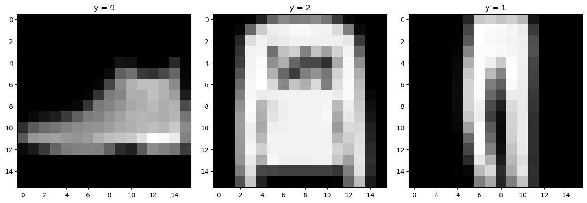
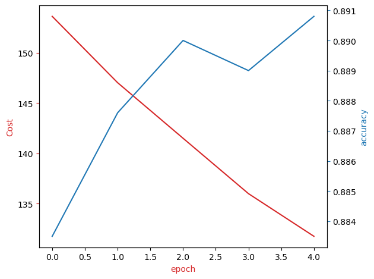

# Fashion-MNIST CNN Classifier

Classifying clothing images from the **Fashion-MNIST** dataset with a **convolutional neural network (CNN) with batch normalization**, built in PyTorch.


---

## Table of Contents

1. [Overview](#overview)
2. [Dataset](#dataset)
3. [Project Workflow](#project-workflow)
4. [Model Architecture](#model-architecture)
5. [Training Setup](#training-setup)
6. [Results](#results)
7. [Repository Structure](#repository-structure)
8. [Getting Started](#getting-started)
9. [Limitations and Future Work](#limitations-and-future-work)
10. [Tech Stack](#tech-stack)
11. [Acknowledgements](#acknowledgements)
12. [License](#license)

---

## Overview

Fashion-MNIST is a popular image-classification benchmark made of small grayscale images of clothing items. This project builds and trains a CNN that assigns each image to one of **10 clothing categories**.

What the project covers:

- Loading and transforming image data with `torchvision`
- Building a CNN with two convolution blocks and batch normalization
- Training with Cross-Entropy loss and SGD
- Tracking training cost and validation accuracy for every epoch
- Visualizing the training progress

## Dataset

[Fashion-MNIST](https://github.com/zalandoresearch/fashion-mnist) from Zalando Research is downloaded automatically by `torchvision` the first time the notebook runs.

| Property | Value |
|---|---|
| Training images | 60,000 |
| Validation images | 10,000 |
| Original image size | 28 x 28 grayscale |
| Image size used here | **16 x 16** (resized to speed up training) |
| Classes | 10 |

**Class labels**

| Label | Class | Label | Class |
|---|---|---|---|
| 0 | T-shirt / top | 5 | Sandal |
| 1 | Trouser | 6 | Shirt |
| 2 | Pullover | 7 | Sneaker |
| 3 | Dress | 8 | Bag |
| 4 | Coat | 9 | Ankle boot |

**Sample validation images** (resized to 16 x 16): an ankle boot (9), a pullover (2) and a trouser (1).



## Project Workflow

| Step | Task | What was done |
|---|---|---|
| 1 | Prepare the environment | Installed and imported PyTorch, torchvision, matplotlib and PIL |
| 2 | Create the datasets | `Compose` with `Resize((16, 16))` and `ToTensor`; loaded `dataset_train` (`train=True`) and `dataset_val` (`train=False`) |
| 3 | Build the CNN | `CNN_batch` class (convolution + batch norm) |
| 4 | Set up training | `CrossEntropyLoss`, SGD with learning rate 0.1, data loaders with batch size 100 |
| 5 | Train and validate | 5 epochs; cost and validation accuracy recorded after each epoch |
| 6 | Visualize | Plotted cost and accuracy per epoch |

## Model Architecture

The model is the `CNN_batch` class in the notebook. A regular `CNN` class without batch normalization is also included for comparison, but the final results use `CNN_batch`.

```
Input  (1 x 16 x 16)
  |
Conv2d(1 -> 16, kernel 5, padding 2) -> BatchNorm2d -> ReLU -> MaxPool(2)     # 16 x 8 x 8
  |
Conv2d(16 -> 32, kernel 5, padding 2) -> BatchNorm2d -> ReLU -> MaxPool(2)    # 32 x 4 x 4
  |
Flatten (512)
  |
Linear(512 -> 10) -> BatchNorm1d(10)                                          # class scores
```

The model has about **18,500 trainable parameters**.

## Training Setup

| Setting | Value |
|---|---|
| Loss function | Cross-Entropy Loss |
| Optimizer | SGD, learning rate 0.1 |
| Batch size | 100 |
| Epochs | 5 |
| Image size | 16 x 16 |
| Random seed | `torch.manual_seed(0)` |

## Results

| Metric | Value |
|---|---|
| **Final validation accuracy** | **89.08%** |
| Final training cost (sum of batch losses, last epoch) | 131.75 |

Over the 5 epochs the training cost falls from about 154 to about 132, while validation accuracy rises from about 88.4% to about 89.1%.



> The red line is the training cost, the blue line is the validation accuracy. Results come from a single run, and exact numbers vary slightly between runs. A clean 5-epoch run from freshly initialized weights typically lands around 88%.

## Repository Structure

```
fashion-mnist-cnn-classifier/
├── notebooks/
│   └── Fashion_MNIST_CNN.ipynb      # Full project notebook with outputs
├── images/
│   ├── validation_samples.png
│   └── training_cost_accuracy.png
├── .gitignore
├── LICENSE
├── README.md
└── requirements.txt
```

## Getting Started

### Prerequisites

- Python 3.7 or newer
- An internet connection (the dataset downloads on the first run)

### Installation

```bash
# 1. Clone the repository
git clone https://github.com/<your-username>/fashion-mnist-cnn-classifier.git
cd fashion-mnist-cnn-classifier

# 2. (Recommended) create a virtual environment
python -m venv .venv
source .venv/bin/activate        # Windows: .venv\Scripts\activate

# 3. Install dependencies
pip install -r requirements.txt
```

For a smaller CPU-only PyTorch build:

```bash
pip install torch torchvision --index-url https://download.pytorch.org/whl/cpu
```

### Run the notebook

```bash
jupyter notebook notebooks/Fashion_MNIST_CNN.ipynb
```

Use **Kernel > Restart & Run All** to run every cell in order. Training takes roughly 4 to 6 minutes on a CPU. The dataset is saved to `.fashion/data` (ignored by git).

> The first cell is a `%pip install` cell written for the Skills Network Labs environment. If you installed the dependencies with `requirements.txt`, you can skip it.

## Limitations and Future Work

- Images are shrunk to 16 x 16, which loses detail. Using the full 28 x 28 size would likely raise accuracy.
- Training uses 5 epochs with a fixed learning rate. More epochs, a learning-rate schedule or a different optimizer such as Adam could improve results.
- The training data loader does not shuffle. Setting `shuffle=True` is the usual practice.
- Validation data is also used to report the final result. A separate test set would give an unbiased estimate.
- Possible extensions: data augmentation, dropout, a deeper network, a confusion matrix and per-class accuracy, and saving the trained model.

## Tech Stack

- **Python**
- **PyTorch** and **torchvision**: model, datasets and training
- **matplotlib**: visualizations
- **Pillow (PIL)**: image handling
- **Jupyter Notebook**

## Acknowledgements

- **Course:** Completed as part of the IBM AI Engineering course (IBM Skills Network).
- **Lab template:** The project structure and instructions come from the IBM Skills Network lab. The notebook's instructional text and starter code are © IBM Corporation, with the authors named in the notebook.
- **My work:** I wrote the transforms, the dataset loading, the optimizer and loss setup, and the analysis, then trained and evaluated the model.
- **Dataset:** [Fashion-MNIST](https://github.com/zalandoresearch/fashion-mnist) by Zalando Research.

## License

My code is released under the [MIT License](LICENSE). The lab instructions and starter code remain © IBM Corporation.
